# A tour of diskOS Disco!

diskOS Disco! is a touch interface for the FiiO Snowsky Disc's round 360×360 screen, built on top of
[diskOS](https://github.com/b0hemia/diskos) by b0hemia. diskOS supplies the installer, the boot chain and the
stock player underneath; Disco! replaces the interface on top. It is made for firmware **V2.57**. Some player
controls differ on older firmware, and a setting that cannot be applied says "Not on this firmware".

**Disco** is the default theme and the one this tour shows. Its idea: the album cover *is* the interface. The
playing album fills the screen, blurred and tinted behind every menu, with a faint CD-rainbow sheen on the rim.
Two more themes, **Ring** and **Braun**, have the same features and settings, laid out differently (see
[Themes](#themes)).

[Home](../README.md) | [How-to](HOWTO.md) | [Docs](README.md)

**Getting it on your Disc:** from Windows with the [diskOS Disco! for Windows](WINDOWS.md) app, or from Linux with the
[installer](../README.md#install).

## On this page

- **Getting around:** [The navigation circle](#the-navigation-circle), [Left-handed mode](#left-handed-mode), [Gestures](#gestures), [Quick Settings](#quick-settings), [Volume](#volume), [Standby](#standby).
- **Listening:** [Music](#music), [The title menu](#the-title-menu), [Queue and Up Next](#queue-and-up-next), [Equalizer](#equalizer), [Working mode](#working-mode), [MA Sendspin](#ma-sendspin-experimental), [Album Roulette](#album-roulette).
- **Play:** [Boomshine](#boomshine), [Listening Stats](#listening-stats), [SongSphere](#songsphere), [Album Roulette](#album-roulette), [Apps](#apps), [Apps in the menu](#apps-in-the-menu).
- **Your library:** [Library](#library), [Hold menus](#hold-menus), [Search](#search), [Shortcuts](#shortcuts).
- **Make it yours:** [Settings](#settings), [Disco Options](#disco-options), [Themes](#themes).
- **More:** [Weather](#weather), [Battery](#battery), [Updates and safety](#updates-and-safety), [Limits](#limits).
- **Optional apps:** [Disc Shelf](#disc-shelf).

## Getting around

### The navigation circle

Disco has no Home screen with buttons. You move between sections with the **navigation circle** on the right
edge of the screen (on the left in [left-handed mode](#left-handed-mode)).

- **Closed**, it is a small dark shard cut into the right rim, showing the icon of the section you are in. Until
  you've used it, a small **Menu** hint points at it after start-up (see [First-use hints](#first-use-hints)).
- **Tap the shard** and the circle slides out of the edge, showing the section's icon and name, with dots for
  every section (Music is always the top dot).
- **Tap the top third** of the circle (or swipe down on it) for the previous section, the **bottom third** (or
  swipe up) for the next one. The screen behind changes as you go.
- **Tap the middle** to open the section at its top level.
- **Hold** the open circle to go straight back to Music, and **double-tap** it to open Search. Both are yours to
  change under Disco Options > Layout > Hold / Double tap (Music, Search, Queue, Up Next, Shortcuts, Quick Settings, Volume, Screen off,
  Play/Pause, Next track or Nothing).
- **Close it** with a tap anywhere outside it, or on the small › at its right end.

The sections are yours to choose under [Disco Options](#disco-options) > Disco Menu: Music, Library, Artists,
Songs, Albums, Search, Queue, Up Next, Folders, Books, Settings, Working mode, Shortcuts, EQ, Weather, Sendspin,
Album Roulette, [Boomshine](#boomshine) and [any app installed on the Disc](#apps-in-the-menu). The circle holds
up to ten. Music and Settings can be moved but never removed, so you can't lock yourself out.

### Left-handed mode

Display > Disco Options > Layout > **Side**: pick **Left** and tap **Apply**; the interface restarts. The circle and
everything that sits around it move to the left: the shard, Quick Settings' music disc, Weather, Working mode,
Shortcuts, the Equalizer, Battery, the edge that lists keep clear and the scroll dots (now on the right rim). The
back swipe starts at the **right** edge. Text still reads left to right, and the arcs keep their direction: the
progress arc starts just above the circle and runs clockwise to just below it.

<table>
<tr>
<td align="center" valign="top" width="33%">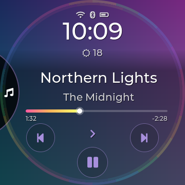<br><sub>Music, shard on the left</sub></td>
<td align="center" valign="top" width="33%">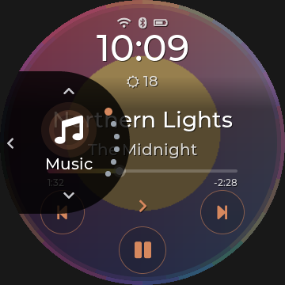<br><sub>The circle opens from the left</sub></td>
<td align="center" valign="top" width="33%">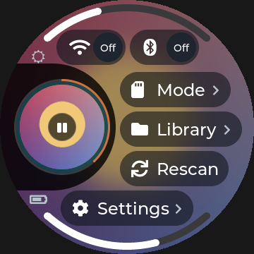<br><sub>Quick Settings, mirrored</sub></td>
</tr>
</table>

Every screen keeps its content clear of the closed shard, and arranges itself around the space the open circle
takes, so nothing important ever hides behind it.

<table>
<tr>
<td align="center" valign="top" width="33%">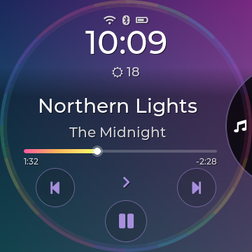<br><sub>Closed: the shard on the right rim</sub></td>
<td align="center" valign="top" width="33%">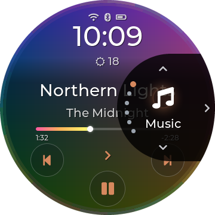<br><sub>Open: icon, name and section dots</sub></td>
<td align="center" valign="top" width="33%">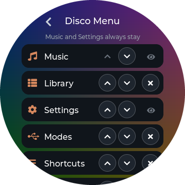<br><sub>Disco Menu: reorder, add, remove</sub></td>
</tr>
</table>

### Gestures

| Gesture | What it does |
|---|---|
| Swipe right from the **left edge** (left-handed: swipe left from the **right edge**) | Back. A bubble with an arrow follows your finger and fills with the accent colour once the swipe will count. |
| Swipe up from the **bottom edge** | Go to Music. A bubble with a home icon rises with your finger, the same way. |
| Pull down from the **top edge** | Open Quick Settings. Swipe up to close it. |
| **Hold** the clock on **Music** | Hide or show the clock, weather and status icons. |
| Swipe left on **Music** (right in left-handed mode) | Open Shortcuts (not when the swipe starts on the progress line or arc: that seeks). |
| Drag along the **rim** of a long list | Scroll fast; a big letter shows where you are. |
| **Hold** a back control | Go straight to Music instead of one step back. |

The distance a back swipe needs can be changed under Display > Text & Layout > Back-swipe.

<table>
<tr>
<td align="center" valign="top" width="33%">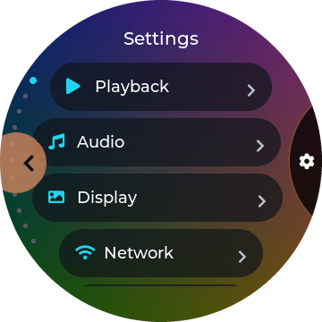<br><sub>Back swipe, armed</sub></td>
<td align="center" valign="top" width="33%">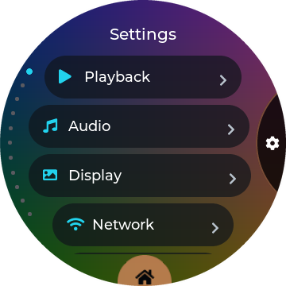<br><sub>Swipe up for Music, armed</sub></td>
</tr>
</table>

### Quick Settings

Pull down from the top edge; swipe up to close. The playing album sits in the round field on the right, with its
progress ring and a play/pause button; tap the cover to go to Music. Drag the **arc at the top** for brightness;
the **arc at the bottom** shows the battery.

Two styles (Disco Options > Quick Settings > Style):

- **Arc** (the default): up to eight round buttons around the music disc.
- **List**: rows on the left that curve and sit like the Library's.

**Items** chooses and orders the buttons. The defaults are Wi-Fi, Bluetooth, Modes, Library, Equalizer, Search,
Rescan and Settings; Queue, Up Next, Shortcuts, Weather, Lyrics, Song Info, Immersive, Folders and Favourites can
be added. Wi-Fi and Bluetooth keep their own fixed places and show the radio's real **On/Off** state. Tap a button
to use it. Hold Wi-Fi or Bluetooth for its settings; hold any other button to see its name. Rescan asks first.

<table>
<tr>
<td align="center" valign="top" width="33%">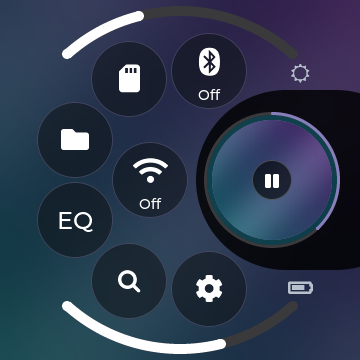<br><sub>Arc</sub></td>
<td align="center" valign="top" width="33%">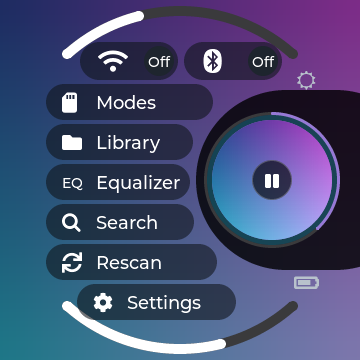<br><sub>List</sub></td>
<td align="center" valign="top" width="33%">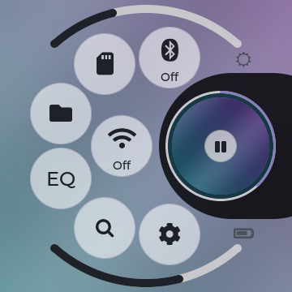<br><sub>Light</sub></td>
</tr>
</table>

### Volume

Press a volume key and the volume pops up over whatever is on screen: the round field on the right shows the
level as a big number, and an arc along the right rim fills from the bottom up. Drag the arc to set the level,
or tap anywhere else to close it; it also closes by itself after a moment. The arc fills in the CD rainbow, or
in your accent colour (Disco Options > Colours > Volume). Audio > Max Volume caps the level.

<table>
<tr>
<td align="center" valign="top" width="33%">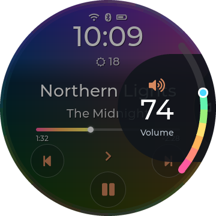<br><sub>The volume field and rim arc</sub></td>
</tr>
</table>

### Standby

After the Screensaver delay (Display > Standby > Screensaver) the screen dims to Disco's standby: the album cover,
darkened, with the weather, a large clock, the song and the artist, and the song's progress as a thin line
around the rim. It redraws only once a minute. A later Screen Off delay can switch the panel off completely.
Touch to wake: a touch on a dark screen only wakes it and never presses anything underneath.

For a pocket or a bag, lock the screen with the **power button**: touch stays off until you press it again.

<table>
<tr>
<td align="center" valign="top" width="33%">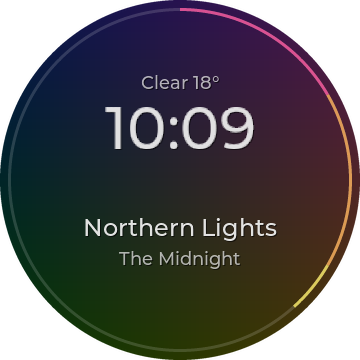<br><sub>Standby</sub></td>
</tr>
</table>

## Listening

### Music

Music is Disco's home: the playing album's cover fills the screen, sharp, with everything laid over it.

- **Top:** Wi-Fi, Bluetooth and battery icons, the time, and the weather. Tap the clock or weather to open
  [Weather](#weather); **hold** it to hide the whole block (hold the same spot to bring it back), or use Disco
  Options > Music Screen > Show Clock.
- **Middle:** the title and artist, large, centred or from the left (Disco Options > Music Screen > Title Position). A long
  name scrolls five times, then settles with "…". **Tap the title** to open [the title menu](#the-title-menu);
  **hold it** to open the cover full screen or to favourite the song (Disco Options > Music Screen > Title Hold).
- **The progress** fills in the CD rainbow (or the accent, or not at all: Disco Options > Colours > Progress Bar). It is
  either a **line** under the title or an **arc** around the rim (Disco Options > Layout > Progress Shape): the arc
  starts just below the open navigation circle, runs clockwise past the bottom and the left, over the top, and
  ends just above it. **Drag or tap either one to seek.** Small elapsed and remaining times sit under the line's
  ends, or side by side in the middle with the arc (Disco Options > Music Screen > Track Times).
- **Below:** previous and next on the sides, play/pause at the bottom, and the **play mode** in the middle:
  tap it to cycle Sequential, Shuffle, Repeat One, Repeat All and Single (a toast names the new mode).

**When nothing is playing** (10 seconds after start-up, or straight away if Resume Playback is off), Music shows
a CD with a rainbow shine instead of a cover, and **Go to Library** where the title would be: tap it to choose
something. The other screens use the same CD behind their glass.

The text is always readable: it is dark on the light theme and white on the dark one, and the soft fade behind
it gets just as strong as each cover needs. The accent colour comes from the cover (or your own choice under
Display > Theme > Accent Colour); a too-dark or too-pale accent is adjusted so it stays visible.

<table>
<tr>
<td align="center" valign="top" width="33%"><br><sub>Dark</sub></td>
<td align="center" valign="top" width="33%">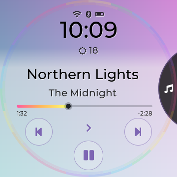<br><sub>Light</sub></td>
<td align="center" valign="top" width="33%">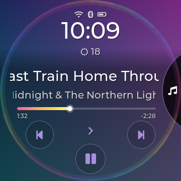<br><sub>A long title scrolling</sub></td>
</tr>
<tr>
<td align="center" valign="top" width="33%"><br><sub>Progress Shape: Arc</sub></td>
<td align="center" valign="top" width="33%">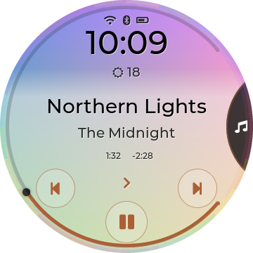<br><sub>Arc in the accent colour</sub></td>
<td align="center" valign="top" width="33%">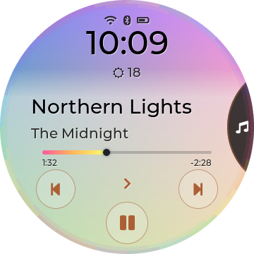<br><sub>Title Position: Left</sub></td>
</tr>
<tr>
<td align="center" valign="top" width="33%">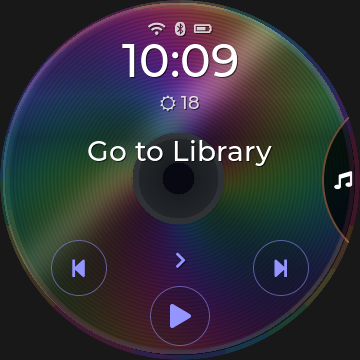<br><sub>Nothing playing: Go to Library</sub></td>
<td align="center" valign="top" width="33%">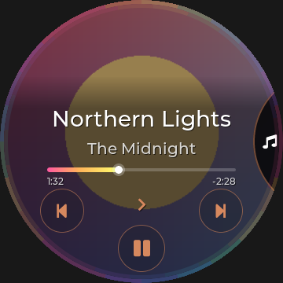<br><sub>Clock hidden with a hold</sub></td>
</tr>
</table>

### The title menu

Tap the title on Music. The cover dims and six buttons appear under the song's name:

| Button | What it does |
|---|---|
| Favourite | Add or remove the song from Favourites (the menu stays open). |
| Album | Open the song's album in the Library, with the song highlighted. |
| Artist | Open the artist's albums, with this album highlighted. |
| Queue | Open your [Queue](#queue-and-up-next). |
| Lyrics | Show the lyrics (from an .lrc file, the song's tags, or online if allowed). |
| Info | Open Song Info as a readable album back sleeve. |

Tap the song's name at the top to close the menu. **Holding** the title on Music (instead of tapping it) goes
straight to Immersive or toggles Favourite, whichever you chose under Disco Options > Music Screen > Title Hold.

<table>
<tr>
<td align="center" valign="top" width="33%">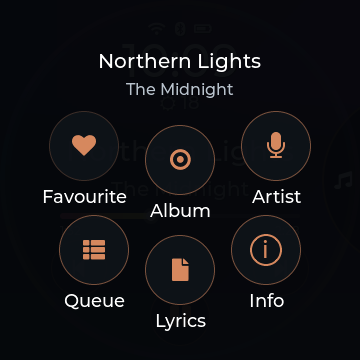<br><sub>The title menu</sub></td>
<td align="center" valign="top" width="33%">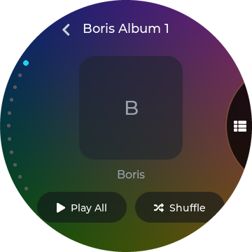<br><sub>Album: straight to the album</sub></td>
</tr>
</table>

### Song Info: the back sleeve

Tap the title on Music and choose **Info**, or hold a library track and choose Info.
The cover stamp, title and artist sit above a readable metadata card: the back of the record sleeve.
Back returns to the screen you came from.

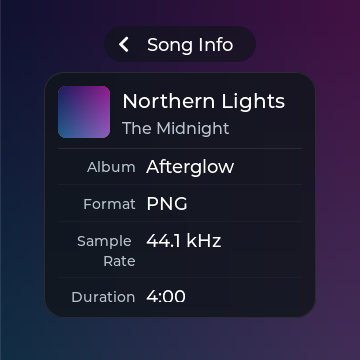

### Queue and Up Next

**Queue** is your own list of songs to play next. Add songs with **Add to queue** in any [hold menu](#hold-menus).
Queued songs play right after the current song, in the order you added them, with Shuffle and Repeat paused
while they play; then playback returns to whatever you were listening to before. On the Queue screen:

- tap a song to play it now (the ones before it are skipped);
- drag a song by its handle (≡) to move it;
- Play starts the queue, the shuffle button shuffles it, and Clear empties it (tap twice to confirm).

The playing song sits at the top, the queue below it. Buttons that can't do anything yet are dimmed. The queue
survives a restart.

**Up Next** shows the player's own order from the current song on, up to 100 songs. Tap a song to jump to it.

<table>
<tr>
<td align="center" valign="top" width="33%">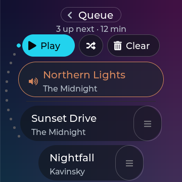<br><sub>Queue</sub></td>
</tr>
</table>

### Equalizer

Open EQ from the navigation circle or a shortcut. The first screen picks the preset: Off, the player's built-in
presets (Jazz, Rock, R&B, Hip-Hop, Pop, Dance, Classical, Retro, Sibilance 1 and 2) and ten presets of your own
(USER1–USER10, which you can rename). **Edit** opens the band editor.

The editor shows ten bands as rainbow faders, each filled up or down from 0 dB in its own colour (or all in
the accent: Disco Options > Colours > Equalizer):

- **tap a band** to select it; **drag the selected band** up or down to set its gain;
- **double-tap** a band to reset it to 0 dB;
- under the faders, tap the **frequency** or the **gain** to choose what − and + change: gain moves 0.1 dB a
  tap, frequency 1/12 octave a tap; hold − or + to repeat; tap the active value again to type it;
- the larger preset pill at the top switches presets; the **<** beside it leaves edit mode.

Disco spreads the ten bands across the screen, with larger labels and a **Choose a band** prompt.

Gains run from −6 to +6 dB. Built-in presets are shown greyed out and can't be edited; only your own presets
are written to the player, and only when you change something.

<table>
<tr>
<td align="center" valign="top" width="33%">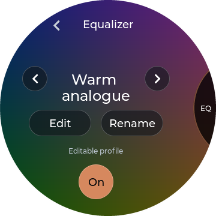<br><sub>Preset choice</sub></td>
<td align="center" valign="top" width="33%"><br><sub>Band editor (dark)</sub></td>
<td align="center" valign="top" width="33%">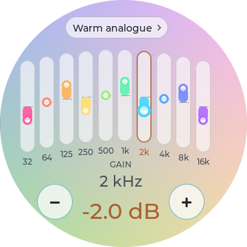<br><sub>Band editor (light)</sub></td>
</tr>
</table>

### Working mode

Choose where the music comes from and goes to: **Playback** (normal listening), **USB storage** (the computer
sees the card; eject it there before switching back), **Bluetooth DAC**, **USB DAC** and **AirPlay**. The active
mode has an accent outline and a tick; while a change is in progress, spinning arrows take the tick's place.
While a mode other than Playback is active, its own screen shows what is connected; tap **Modes** there, then
**Playback**, to go back to normal listening.

**USB DAC** needs 2.2.1 or later on the latest player firmware (V2.57): in 2.2.0 and earlier the computer played
but the Disc stayed silent.

<table>
<tr>
<td align="center" valign="top" width="33%">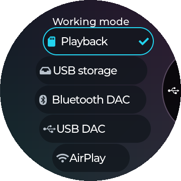<br><sub>Working mode</sub></td>
</tr>
</table>

### MA Sendspin (experimental)

A Sendspin player for [Music Assistant](https://www.music-assistant.io/): the Disc shows up in Music Assistant as a
speaker. While Music Assistant plays to it, **Music** shows the track like any song (title, artist, cover,
progress, Immersive) and its play/pause, next, previous and seeking control Music Assistant. The Disc stays awake
while it plays.

- **Turn it on** with **Sendspin** in the navigation circle (add it in Disco Options > Disco Menu) or in
  Settings > Network > MA Sendspin. It switches the Disc to AirPlay (the sound goes through the Disc's own AirPlay
  receiver) and waits for Music Assistant; picking another working mode turns it off. It comes back on after a
  restart if it was on.
- **Settings > Network > MA Sendspin:** **Server** (Auto finds Music Assistant on your network; tap to type its
  address instead), **Player Name** (how the Disc is called there), **Sync Delay** (-2000 to +2000 ms, moves the
  Disc's sound later or earlier to line it up with other speakers).
- The Sendspin screen shows the connection: Off, Looking for Music Assistant, Ready, Playing or Paused with the
  track, Can't reach Music Assistant (it keeps trying), or Wi-Fi is off (it connects once Wi-Fi is on).
- **Renamed the player** (or played with an older test version)? Music Assistant can keep the old entry as a second
  player with the same name. Play to the one that responds, and remove the stale one in Music Assistant's player
  settings.

*Experimental.* Made for Music Assistant 2.10, which still accepts the older ("legacy") Sendspin connection this
uses; a later Music Assistant that drops it will need a Disco update. The Disc's physical buttons still control the
built-in player, and streaming over Wi-Fi uses more battery than playing from the card.

<table>
<tr>
<td align="center" valign="top" width="33%">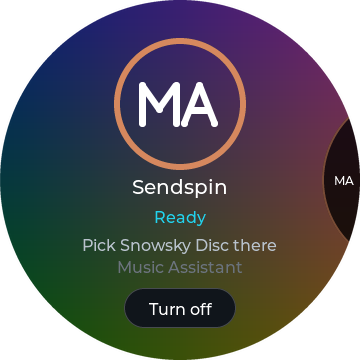<br><sub>Sendspin, ready</sub></td>
<td align="center" valign="top" width="33%">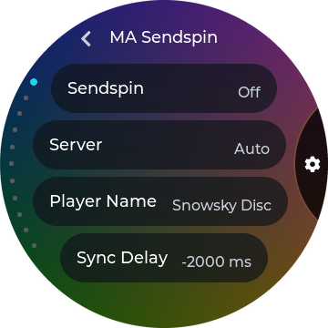<br><sub>Settings > Network > MA Sendspin</sub></td>
</tr>
</table>

## Your library

### Library

Library opens Songs, Albums, Artists, Genres, Playlists, Favourites, Folders, Books and History. Lists follow
the curve of the screen, with scroll dots on the left; an **A - Z** pill at the bottom jumps to a letter (in
Folders too, once a folder holds more than a dozen entries). Albums can be a list or a cover flow (Display > Album
View). Tap a song to play it; song lists have Play and Shuffle at the top. Artists and Genres open their albums plus
"All Songs"; going back from an artist lands on that artist in the list.

Going back returns you to where you were in a list (until the interface restarts). Long lists briefly show your
position while you scroll.

**Books** keeps .m4b audiobooks apart from music, resumes where you stopped, and has chapters. **Folders**
browses the card itself.

<table>
<tr>
<td align="center" valign="top" width="33%">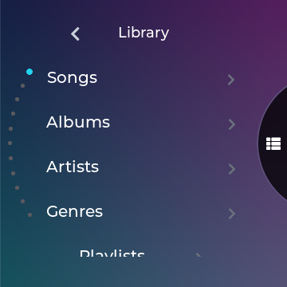<br><sub>Library</sub></td>
<td align="center" valign="top" width="33%">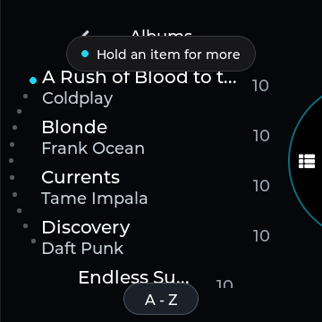<br><sub>Albums, with the A-Z pill</sub></td>
</tr>
</table>

### Hold menus

Hold a row in the Library for its actions (**Queue** in a menu means Add to queue):

| Hold a… | Menu |
|---|---|
| Song | Add to queue, Playlist, Favourite, Album, Artist, Info, Tags. |
| Album | Play, Shuffle, Add to queue, Playlist, Tags (looks up tags for every track of the album). |
| Artist or genre | Play, Shuffle, Add to queue, Playlist. |
| File (Folders) | Add to queue, Playlist, Favourite, Info, Tags, Rename, Copy / Move, Delete. |
| Folder (Folders) | Add to queue, Playlist, Tags, Rename, Copy / Move, Delete. |

A tap still plays; the menu only opens on a hold, and a song never starts playing when you let go of a hold.
Song **Info** shows the format, sample rate, length, folder and the file size with its bitrate.

<table>
<tr>
<td align="center" valign="top" width="33%">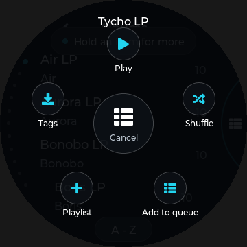<br><sub>Holding an album</sub></td>
<td align="center" valign="top" width="33%">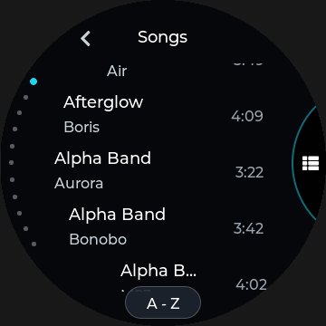<br><sub>Scroll: Disco</sub></td>
</tr>
</table>

### Search

Choose **Search** in the navigation circle. The landing page has a big **Search library** row and your three
most recent searches.

1. Tap **Search library** for the full-screen keyboard: big keys, 123 for digits and symbols, Backspace (tap to
   delete one letter, hold to clear).
2. Typing doesn't search yet. Press **Search** when you're ready.
3. Results list **matching artists first** (tap one to open their albums), then a line, then the songs. Tap a
   song to play it, or hold it for its menu.

Back goes from the results to the keyboard (your text kept), then to the landing page. A recent search jumps
straight to its results.

<table>
<tr>
<td align="center" valign="top" width="33%">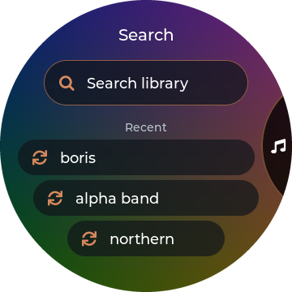<br><sub>Landing page</sub></td>
<td align="center" valign="top" width="33%">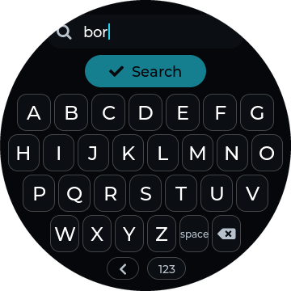<br><sub>Keyboard</sub></td>
<td align="center" valign="top" width="33%"><br><sub>Artists first, then songs</sub></td>
</tr>
</table>

### Shortcuts

Swipe left on Music (or pick Shortcuts in the navigation circle) for five shortcuts of your choice. Choose them
under Display > Online & Extras > Shortcuts from: Weather, Immersive, Equalizer, Folders, Lyrics, Queue, Audiobooks, Search,
Battery, Song Info, Last.fm, All apps, Boomshine, and any app installed on the Disc (such as Disc Shelf or Album Roulette).
**All apps** lists the apps five at a time; tap its title for the next page.

<table>
<tr>
<td align="center" valign="top" width="33%">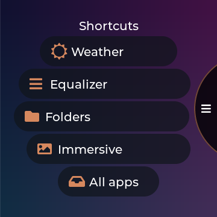<br><sub>Shortcuts</sub></td>
</tr>
</table>

## Make it yours

### Settings

Settings opens Playback, Audio, Display, Network, System and Battery. Each page is a curved list, four rows in
view; tap a row to cycle its value, open it, or run it. Display and System are split into short pages so there's
little scrolling, and back steps up one page at a time. Settings that only matter for Disco are gathered in
[Disco Options](#disco-options); those that don't apply to Disco (Now Playing style, Disc Colour, Saver Style) are
hidden while Disco is on.

| Page | What's in it |
|---|---|
| Playback | Play Mode, Equalizer, Up Next, Auto-tag, Custom EQ, Resume Playback (Off / Song / Position), Artists by artist or album artist, Play Through Folders. |
| Audio | Working Mode, Gain, DAC Filter, ReplayGain, DRE, Gapless, Max Volume, Balance. |
| Display | **Brightness**; **Theme** (Theme, Appearance, Automatic Appearance, Outdoor Mode, Accent Colour); **Disco Options**; **Text & Layout** (Font Size, Screen Rotation, 24-Hour Time, Track Numbers, Animations, Back-swipe, **Immersive**: Vinyl, CD or None, **Immersive Lyrics**: on or off); **Standby** (Screensaver, Screen Off); **Online & Extras** (Online Album Art, Online Lyrics, Album Art Cache, Weather on Home, Shortcuts, Album View). |
| Network | Wi-Fi, MA Sendspin, Bluetooth, Bluetooth Codec (SBC, AAC, LDAC levels). |
| System | **Power** (Sleep Timer, When Sleep Ends, Idle Power-off, Charging Limit, Shut down player); **Date & Time**; **Library** (Rescan, Import Playlists); **Controls** (Volume Keys, Default UI, Language); **Maintenance** (Update from SD Card, Restart, Reset diskOS Settings, Debug Mode); **Help** (First-use hints, Show hints again); **About** (About, Device Info, Temperature). |
| Battery | The [battery](#battery) page. |

Font Size changes the text of lists, titles and search results.

Typing (a Wi-Fi password, the Sendspin server or name, a playlist name) uses a big keyboard like Search's: **Aa**
for a capital, **123** and **#+=** for digits and symbols, Backspace (hold to clear), then the tick to save.

<table>
<tr>
<td align="center" valign="top" width="33%">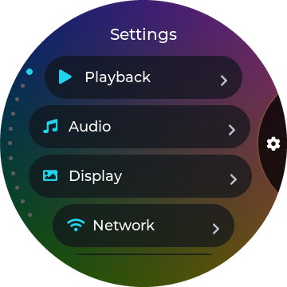<br><sub>Settings</sub></td>
<td align="center" valign="top" width="33%">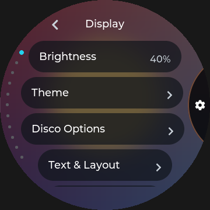<br><sub>Display: six short pages</sub></td>
<td align="center" valign="top" width="33%">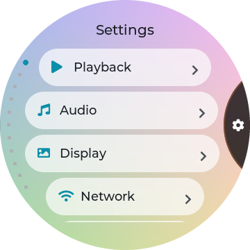<br><sub>Light</sub></td>
</tr>
</table>

### Disco Options

Display > Disco Options (only shown with the Disco theme):

| Page | Rows |
|---|---|
| Disco Menu | The sections of the navigation circle: reorder, add, remove. |
| Music Screen | **Track Font** (Original, Inter Semibold or Nunito Bold; larger alternatives with international/CJK fallbacks), **Show Clock** (clock, status icons and weather; holding the clock does the same), **Track Times**, **Number Before Title** ("3. Northern Lights", from the tags), **Title Position** (Centred or Left), **Title Hold** (Immersive, Favourite or Nothing). |
| Colours | **Rim Sheen** (the faint CD rainbow round Music and playlists), **Equalizer** and **Volume** (Disco rainbow or Accent), **Progress Bar** (Disco, Accent or Off). |
| Quick Settings | **Style** (Arc or List) and **Items** (choose and order up to eight buttons). |
| Layout | **Double tap** and **Hold** on the open navigation circle, **Progress Shape** (Linear under the title, or Arc round the rim), **Side** (Right or Left, then Apply: see [left-handed mode](#left-handed-mode)) and **Scroll**: Classic (rows follow the screen's edge), Straight (flat rows) or Disco (rows swing round the navigation circle like a CD, the times in one straight column). |

<table>
<tr>
<td align="center" valign="top" width="33%">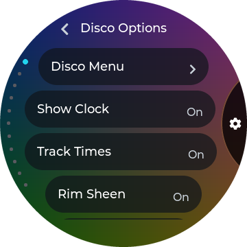<br><sub>Disco Options</sub></td>
<td align="center" valign="top" width="33%">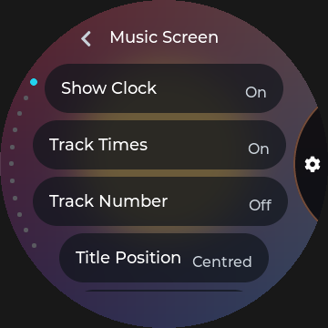<br><sub>Music Screen</sub></td>
<td align="center" valign="top" width="33%">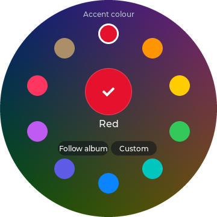<br><sub>Accent colour</sub></td>
</tr>
</table>

### Themes

Display > Theme. Every theme has a Dark and a Light appearance, and Automatic Appearance can switch between them
by the time of day.

| Theme | Look |
|---|---|
| **Disco** | The album cover as the interface; glass panels, a CD sheen, the navigation circle on the right edge. |
| **Ring** | Black (or off-white in Ring Light), the cover in a progress ring, round orbit menus, red or lime button rims. |
| **Braun** | 1970s hi-fi: a speaker-grille face, an analogue clock, knobs and faders, orange accents. |
| Stone | diskOS's rounded theme, kept from upstream. |

**Ring and Braun** work the same way as Disco with one difference: there is no navigation circle. Their
**Home** screen holds the clock and the playing song, with buttons for the Library, playback and Search, and
the sections are reached from Home and from round "orbit" menus around a central back button. The gestures,
settings, Queue, Search, hold menus, EQ functions and Quick Settings are the same.

#### Ring

The progress ring is the whole idea. On **Home** the clock sits inside the playing song's progress ring, with the
date and weather above it and the cover riding along the ring. **Now Playing** shows a round cover with the progress
ring hugging it (drag the ring to seek), the heart and the play mode at the ring's sides, and large title and
artist. Menus are round "orbits" of buttons. Ring is black with red button rims; **Ring Light** is off-white with
lime. Music surfaces follow the album colour, or your own Accent Colour.

#### Braun

A 1970s hi-fi in the spirit of Dieter Rams' Braun SK4 radio. **Home** is an analogue clock dial on a speaker-grille
face, with the weather in a small window and the song on a solid panel that follows the round edge. Switches are
knobs (off points up, on turns 45° and goes orange), the equalizer is a fader bank, the volume popup is a rim scale
with a big number, and lists stay straight with a single orange dot for the current row. **Braun** is warm white;
**Braun Dark** is charcoal with aluminium knobs.

#### Stone

diskOS's own rounded theme, kept from upstream: pill-shaped controls, a clock split into hour and minute blocks, and
on Now Playing a thick seek ring with a pill-shaped play key. It keeps upstream's Home and Now Playing screens; menus,
lists and popups follow this project's layouts in Stone's colours and fonts.

<table>
<tr>
<td align="center" valign="top" width="25%">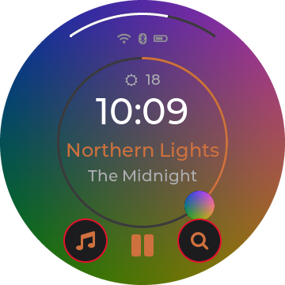<br><sub>Ring</sub></td>
<td align="center" valign="top" width="25%"><br><sub>Ring Light</sub></td>
<td align="center" valign="top" width="25%">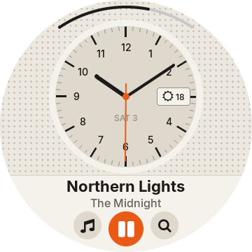<br><sub>Braun</sub></td>
<td align="center" valign="top" width="25%"><br><sub>Braun Dark</sub></td>
</tr>
<tr>
<td align="center" valign="top" width="25%">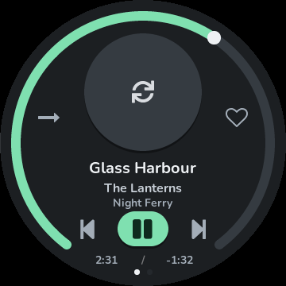<br><sub>Stone (Now Playing)</sub></td>
</tr>
</table>

## More

### Weather

Weather shows the current conditions in the round field on the right (icon, temperature, sky, place, today's
high and low) and the next 12 hours in 3-hour rows on the left. **Tap the place** to type a city; **hold it** to
go back to automatic location (by your internet connection). Weather needs Wi-Fi; Display > Online & Extras > Weather on Home
turns it off.

<table>
<tr>
<td align="center" valign="top" width="33%">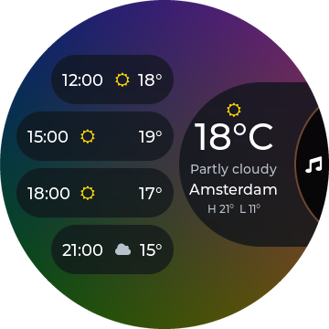<br><sub>Dark</sub></td>
<td align="center" valign="top" width="33%">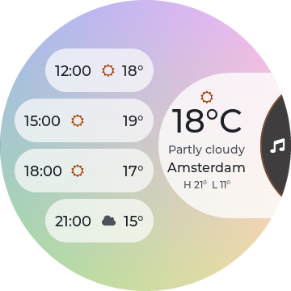<br><sub>Light</sub></td>
</tr>
</table>

### Battery

Settings > Battery (or a shortcut) shows the charge on an open gauge on the navigation circle's side (green while
charging, red at 15% or less), the percentage, the time left at your recent pace, and two figures **since the last full charge**
(and how long ago that was): time spent playing and time with the screen on. A full charge is 95% or more (the Disc seldom shows 100%), or 80%
with Charging Limit on, counted when you unplug (or start the Disc up full after charging it switched off). Until a full
charge has been seen, the figures cover the last 24 hours. The estimate uses only your latest unbroken stretch of
discharge (a charge, a level that went up or the Disc being off starts a new one), so it settles after about
half an hour on battery. Without a set clock the figures show "-".

<table>
<tr>
<td align="center" valign="top" width="33%">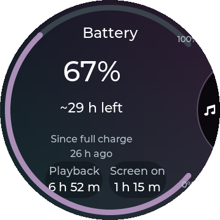<br><sub>Battery</sub></td>
</tr>
</table>

### Updates and safety

- **Updates from the SD card or a flash.** There are no online updates. Settings > System > Maintenance > Update from SD Card installs a signed update from the
  card's `diskos-update` folder. Every update is checked twice (when it is copied in and again at start-up),
  then runs as a **trial**: it becomes permanent only after music has actually played or you tap **Keep** on
  the one-time question. A trial that never proves itself, or keeps crashing, is rolled back to the previous
  version automatically. See [How-to](HOWTO.md#update-from-the-sd-card).
- **The stock interface is always there.** If the Disco! interface ever stops, the Disc falls back to FiiO's
  own interface until the next restart; your music and settings are untouched. Settings > System > Controls > Default UI
  can make stock the normal choice, and holding Volume Up from power-on boots the other interface once.
- **Settings > System > About** shows the version with the exact build ID.
- <a id="first-use-hints"></a>**First-use hints.** Small tips point out the navigation circle, hold menus and the
  Music title. Each disappears on touch and retires once you've used the feature. System > Help > First-use hints:
  Automatic, On or Off; **Show hints again** brings them back.
- **The rescan dot.** While the library is being rescanned, a small dot runs around the rim of the screen.

<table>
<tr>
<td align="center" valign="top" width="33%">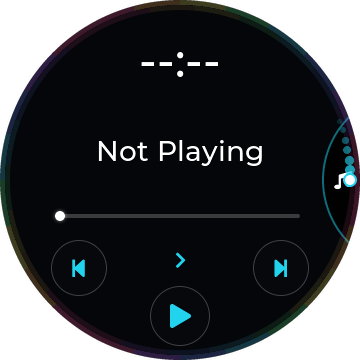<br><sub>The rescan dot on the right rim</sub></td>
<td align="center" valign="top" width="33%">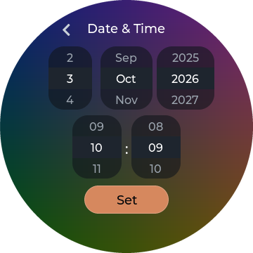<br><sub>Date &amp; Time</sub></td>
</tr>
</table>

### Limits

- Made for firmware V2.57. Older firmware can lack some player controls (they say "Not on this firmware").
- With both Wi-Fi and Bluetooth on at shutdown, the stock player keeps Bluetooth and turns Wi-Fi off at the
  next start; Disco! follows that so the two radios don't fight.
- Search shows up to 80 songs (and up to 4 artists); type more to narrow it down.
- Bluetooth output, Last.fm and AirPlay are still experimental.
- This is a hobby project, provided as-is, for testing. Not affiliated with FiiO or Snowsky.

## Boomshine

**One tap, one chain reaction.** Dots drift around the round screen. Tap once to set off a blast: every dot it
catches bursts too, and so on down the chain. Catch enough dots to clear the level; twenty levels, each one
busier than the last. Built in since 1.5.0, so there is nothing to install.

1. Add **Boomshine** to the menu (Disco Options > Disco Menu), or open it from All apps or a Shortcut.
2. Its landing page shows the game's name and a **Play** button. Moving past it in the navigation circle only
   shows this page; the game starts when you tap **Play**.
3. Pick a look: **NeoN** (bright rings on black) or **Pop!** (soft pastels on deep blue). Same levels, same score.
4. Tap anywhere to fire your one shot. The top shows caught / needed, the bottom the level.
5. Hold a still finger for about a second to return to the game's start page; **Exit** there takes you back to
   Disco. Your music keeps playing (the game is silent), and your best score and level are saved.

If the game ever stops responding, hold **Volume Up** for 3 seconds to close it.

<table>
<tr>
<td align="center" valign="top" width="25%">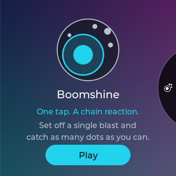<br><sub>Landing page</sub></td>
<td align="center" valign="top" width="25%"><br><sub>NeoN or Pop!</sub></td>
<td align="center" valign="top" width="25%"><br><sub>NeoN</sub></td>
<td align="center" valign="top" width="25%"><br><sub>Pop!</sub></td>
</tr>
</table>

## Listening Stats

**Your music, in numbers.** Built in: add **Stats** to the menu (Disco Options > Disco Menu), or open
**Listening Stats** from Apps, All apps or a Shortcut. Its landing page reads nothing until you tap **Show me**.

- **Week, Month or Year** on the arc at the top; swipe the period below it (or tap a neighbour) to go back in time.
- **The overview:** how long you listened, how that compares (while a period is running, with the same stretch of the
  one before), and how many songs, albums and artists.
- **Top Artists, Top Albums, On repeat:** the top 5 of each, the #1 big with its cover. Tap a section's title for its
  **top 15**; tap the #1 cover for its **Wrapped**: the covers as bubbles, then the top 5 with their colour and time.
  Artists follow Settings > Playback > Artists (by artist or by album artist).
- **When you listen:** your listening by the hour, round the rim, with your busiest hour in the middle.

Scroll it like the Library. A song counts once it has played for 30 seconds (or almost all of a shorter one), and
only the time it really played adds up: pauses and skipping ahead don't. Audiobooks are left out. Nothing leaves the
Disc.

<table>
<tr>
<td align="center" valign="top" width="25%"><br><sub>The month</sub></td>
<td align="center" valign="top" width="25%"><br><sub>Top artists</sub></td>
<td align="center" valign="top" width="25%"><br><sub>Wrapped</sub></td>
<td align="center" valign="top" width="25%"><br><sub>When you listen</sub></td>
</tr>
</table>

## Apps

**Your apps, one tap away.** Add **Apps** to the menu (Disco Options > Disco Menu): up to five apps you choose, each
with its icon. Tap one for its landing page. **Choose apps** (under the list) picks them: tap to add or remove; the
number is the order. Until you choose, the first five are shown. App makers can give their app an icon: `icon=` in
its `app.conf`, or an `icon.bmp` in its folder.

<table>
<tr>
<td align="center" valign="top" width="50%"><br><sub>Apps</sub></td>
<td align="center" valign="top" width="50%"><br><sub>Choose apps</sub></td>
</tr>
</table>

## Apps in the menu

Since 1.5.0, **every app installed on the Disc** can sit in the navigation circle next to the built-in sections.

- **Add one:** Disco Options > Disco Menu lists installed apps after the built-in entries. Add, reorder or remove
  them like any section. They keep their place even when you install more apps later; if you remove an app, its
  entry quietly disappears.
- **Open one:** choosing an app in the circle shows its **landing page**: a picture, the name, a short line and
  one button. Nothing starts until you tap that button, so browsing through the circle never launches anything.
- **Leave one:** use the app's own Exit; you come back to Disco. Holding **Volume Up** for 3 seconds closes an app
  that stopped responding.

Apps that don't describe themselves get a plain page: their first letter, "Installed app" and **Launch**. App
makers can set the rest in the app's `app.conf` (next to `name=` and `exec=`):

```ini
tagline=Your Navidrome, on the card.
about=Browse your server and save\noriginal files to the card.
button=Open Disc Shelf
```

`about` shows up to two lines; `\n` starts the second. Album Roulette keeps its own vinyl page.

<table>
<tr>
<td align="center" valign="top" width="33%"><br><sub>In the circle</sub></td>
<td align="center" valign="top" width="33%"><br><sub>An app that describes itself</sub></td>
<td align="center" valign="top" width="33%"><br><sub>The default page</sub></td>
</tr>
</table>

## SongSphere

**Music by mood**, built in since 2.2.0 (Settings > Playback > SongSphere turns it off). Place your music on a sphere,
from Calm to Energetic and from Dark to Bright, by dragging the marker, then drag to the mood you're in and play.

- **Place music:** in SongSphere (Place Music: albums or artists, most played first), or straight from where you
  are: hold an album or an artist in the Library and choose **Mood**, or tap the mood pill in Music's track popup to
  place the song playing. A song uses its own spot, else its album's, else its artist's; the pill shows which.
- **Play a mood:** open SongSphere (Disco Menu, Apps, All apps), **Play Music**, drag the marker, **Play mood**: up to
  40 songs from near that spot, a few per album and artist, recent plays less likely, in Shuffle, kept as a playlist
  if you like.

Placements live on the Disc (`/usr/data/songsphere.db`). If you used the 2.1 add-on, they carry over.

<table>
<tr>
<td align="center" valign="top" width="33%"><br><sub>First page</sub></td>
<td align="center" valign="top" width="33%"><br><sub>Place an album</sub></td>
<td align="center" valign="top" width="33%"><br><sub>Play a mood</sub></td>
</tr>
</table>

## Album Roulette

**A little record-shop serendipity, using the music you already own.** Album Roulette picks an album from your
local library and turns the choice into a roulette spin. Circular covers race across the screen like discs in a
CD changer, slow down, and settle on one winner. You decide whether to play it.

The album you forgot you loved gets the same chance as the one you played yesterday, and playback waits for your
tap. The winner plays in track order.

### How a spin works

1. Open **Album Roulette** from the navigation circle, Apps, All apps or a shortcut: its vinyl page. Tap
   **I feel lucky!**
2. The roulette wheel turns while up to 37 albums from your library are prepared (covers you've seen before come
   straight from the card's cache). Then the spin starts by itself: round covers fly from right to left, fast at
   first, then slower, until the winner comes to rest with its title and artist.
3. Tap the white **Play!** ball **or the winning cover**. The cover zooms into Music and the album plays in track
   order.
4. Fancy another go? **Hold the winning cover** for a fresh spin (the last three winners sit it out). Back, or
   **Exit** on the wheel, returns to the vinyl page without playing anything.

Only albums with **more than three tracks** take part. That keeps singles and stray tracks out of the draw. It works
with your indexed local collection; it doesn't fetch new music.

Album Roulette is **built in since 2.2.0**. If you installed the separate app before, it's no longer used:
[remove it](ALBUM_ROULETTE_INSTALL.md).


## Disc Shelf

**Your [Navidrome](https://www.navidrome.org/) server, one tap from the card.** Disc Shelf is a separate app that
browses your server's artists and albums and downloads the **original files** (no transcoding) straight to the
SD card, so they play offline like the rest of your library.

- **Browse:** Browse collection opens your artists. The A-Z picker jumps to a letter (numbers and symbols
  included); an artist shows all of their albums in one list.
- **Pick:** tap the round selectors next to artists or albums, then **Download**. A lime outline means some of
  that music is already on the card (not necessarily all of it).
- **Download:** files already on the card are skipped, nothing is overwritten, and you can cancel at any time.
  The copy page shows progress and what it is doing.
- **Afterwards:** rescan (Settings > System > Library > Rescan, or the Quick Settings button) so the new music shows up.
- **Getting around:** Back goes up one level; Exit is on Disc Shelf's own start page. It follows your theme and
  light or dark appearance.

**Setting it up** takes one small text file, `shelf.conf`, with your server address, username, password and the
card folder to download into. The [install guide](DISC_SHELF_INSTALL.md) walks through it. Add Disc Shelf to the
navigation circle (Disco Options > Disco Menu), to Shortcuts, or open it from All apps. Like Album Roulette, it is
installed separately: SD updates of the interface don't install or change it.

**Good to know:** your password is stored as plain text on the Disc (readable only by the system), so use a
Navidrome account meant for this. Disc Shelf needs Wi-Fi and a server the Disc can reach.

<table>
<tr>
<td align="center" valign="top" width="33%"><br><sub>From the menu</sub></td>
<td align="center" valign="top" width="33%"><br><sub>Disc Shelf's start page</sub></td>
</tr>
</table>
