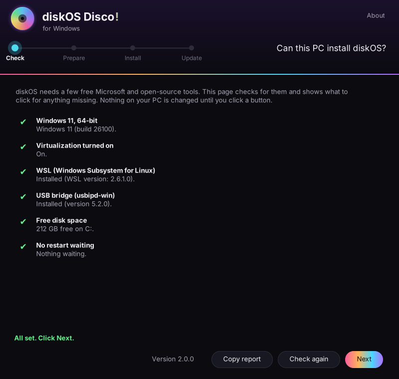
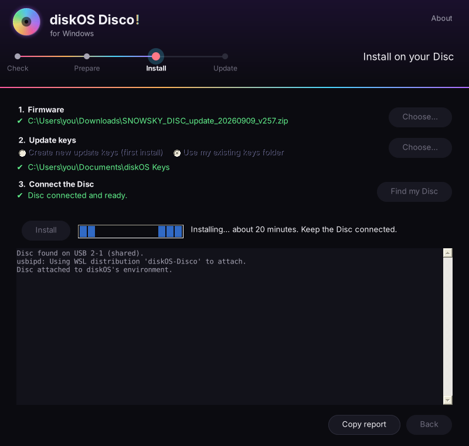
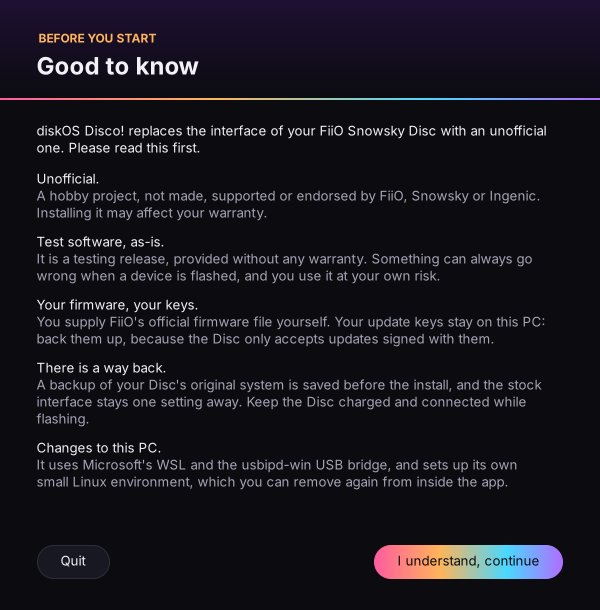
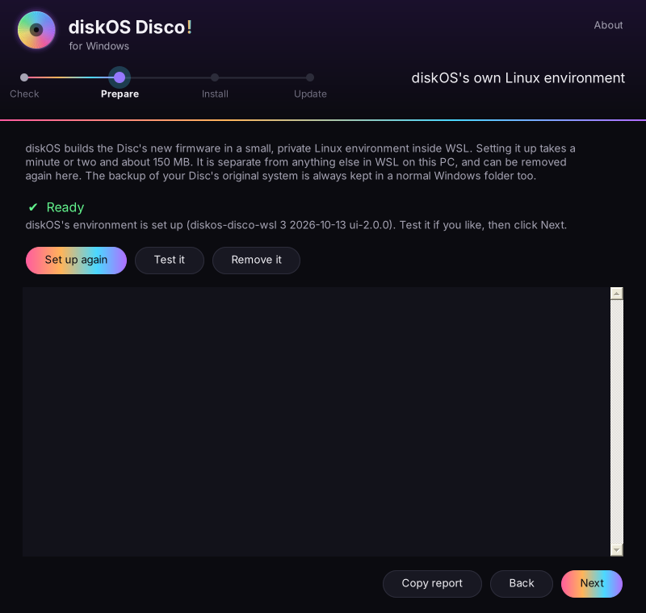
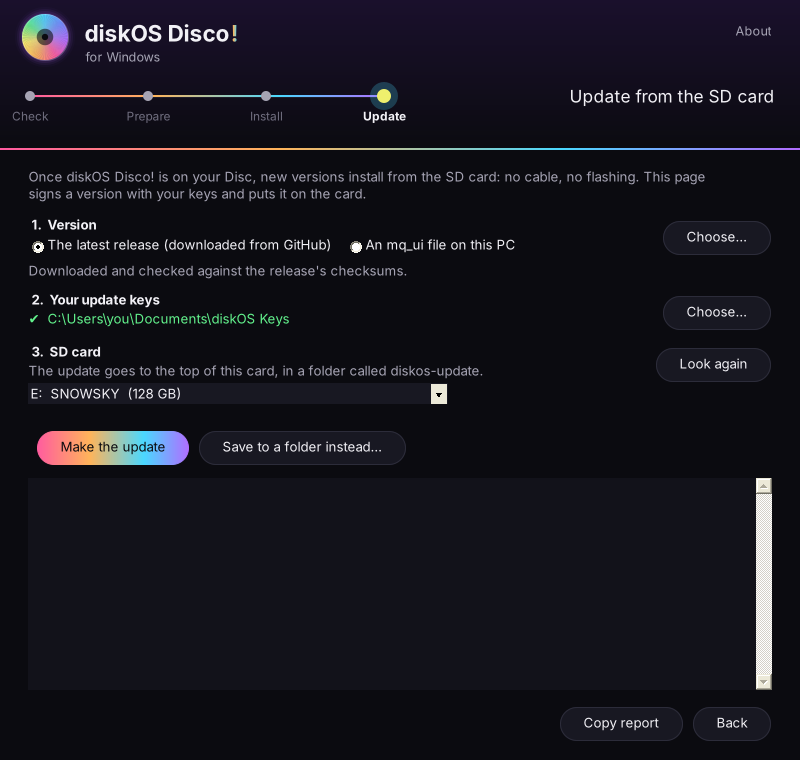

# diskOS Disco! for Windows

[Back to the README](../README.md) · [Tour](DISCO_TOUR.md) · [SD updates](UPDATING.md)

> **Unsupported, but working as intended:** confirmed several times by users, installs and SD updates included. There is no help
> for Windows-specific problems, though. Start from FiiO's stock V2.57 firmware, not another diskOS build:
> installing over upstream diskOS or another diskOS build can be buggy.
>
> **Always the latest version.** Each time the app starts, it checks GitHub for a newer release and, if there is one,
> updates its installer files (the installer, the boot scripts and the interface) before you install, checked against
> the release's checksums. Install and Update also download the latest `mq_ui` each time, unless you choose a file of
> your own. Without internet, the app uses what it already has.

> Switched to Disco from upstream diskOS or another build, and something looks or behaves wrong? **Settings > System > Maintenance > Reset diskOS Settings** gives the interface a fresh start; your music, Wi-Fi, Bluetooth, EQ and audio settings stay. Going back to stock in between does *not* clear what diskOS leaves on the Disc.

**Install diskOS Disco! on your Snowsky Disc from a Windows PC, by clicking through four pages.** No terminal, no
Linux knowledge, no typing commands. The app checks your PC, sets everything up, flashes the Disc, and later puts new
versions on your SD card, signed with your own keys.

  
  

**[Download diskOS-Disco-for-Windows.zip](https://github.com/zmd22/diskos-disco/releases/latest/download/diskOS-Disco-for-Windows.zip)**
(from the latest release)

## What it is

The diskOS installer is a Linux program: it unpacks FiiO's firmware, builds the Disc's new system and talks to the
Disc over USB at a very low level. Windows can't do those things by itself, but it can run Linux on the side with
Microsoft's free **WSL** (Windows Subsystem for Linux), and hand a USB device to it with the free **usbipd-win**.

The app wraps all of that in a friendly window:

- It **checks** that your PC has what it needs, and shows exactly what to click for anything missing.
- It **sets up its own small Linux environment** (about 150 MB), with the installer and everything it needs already
  inside. It's private to diskOS: it never touches other Linux setups you may have, and you can remove it in one click.
- It **installs** diskOS Disco! on your Disc: you pick FiiO's firmware file, it makes your update keys, finds the Disc
  on USB, and flashes it, keeping the PC awake until it's done.
- It **makes SD updates**: it downloads the newest version, signs it with your keys and writes it to the SD card.

The same installer and the same safety checks run as on Linux. Only the way you drive it is different.

## What you need

| | |
|---|---|
| **A Windows 11 PC** | 64-bit, Intel or AMD (not ARM). Windows 10 (22H2) may work but isn't tested. About 10 GB free. |
| **Virtualization on** | Most PCs have it on already; the app checks and links to Microsoft's how-to if not. |
| **Internet, once** | To install WSL and the USB bridge. Flashing itself works offline. |
| **Your Snowsky Disc** | On **firmware V2.57**, charged, with a USB **data** cable plugged straight into the PC (no hub). |
| **FiiO's V2.57 firmware ZIP** | `SNOWSKY_DISC_update_20260909_v257.zip` from FiiO. diskOS builds from your copy and never shares it. |
| **About 30 minutes** | Mostly waiting. Keep the Disc connected while it flashes. |

## Start

1. Download **diskOS-Disco-for-Windows.zip** and extract it (right-click › **Extract All**). Keep `diskOS-Disco.exe` and
   `diskos-wsl.tar.gz` together in one folder.
2. Run **diskOS-Disco.exe**. The app isn't code-signed yet, so Windows may say *"Windows protected your PC"*: click
   **More info**, then **Run anyway**.
3. Read **Good to know** (what this is, and what it isn't), then click **I understand, continue**.

The app itself needs no administrator rights. Windows asks for permission only for the few steps that need it
(installing WSL, and sharing the Disc's USB connection the first time), and the app says beforehand when that's coming.

## Step 1 · Check

The app looks for six things and shows a green tick or a button for each:

| Check | If it's missing |
|---|---|
| **Windows 11, 64-bit** | It explains what's supported. |
| **Virtualization turned on** | **How to turn it on** opens Microsoft's guide (a setting in your PC's BIOS/UEFI). |
| **WSL** | **Install WSL** installs it (Windows asks for permission). Restart Windows afterwards. |
| **USB bridge (usbipd-win)** | **Install USB bridge** opens its installer: Next, Install, Finish. |
| **Free disk space** | Free up space until there's about 10 GB. |
| **No restart waiting** | **Restart now** (often needed right after installing WSL). |

Work from the top, then click **Check again**. When everything is green, click **Next**. **Copy report** copies the
results, handy if you ask for help.

## Step 2 · Prepare

Click **Set up**. The app creates its own Linux environment called **diskOS-Disco** from `diskos-wsl.tar.gz`, then
runs the installer's self-test inside it. That takes a minute or two. It's a minimal Ubuntu with the diskOS installer,
its tools and the newest Disco! interface. It runs only while the app needs it.

- **Test it** runs the self-test again.
- **Remove it** deletes the environment completely.
- After an app update the page may say **Needs updating**: click **Set up again**.

The backup of your Disc's original system (made in step 3) is always copied to a normal Windows folder, so removing or
replacing the environment never loses it.

## Step 3 · Install

1. **Firmware:** click **Choose…** and pick FiiO's V2.57 ZIP.
2. **Version:** **The latest release** (the default) is downloaded from GitHub when you click Install and checked
   against the release's checksums. Or pick **An mq_ui file on this PC**. Without internet, the app offers the version
   built into it instead.
3. **Update keys:**
   - **First install:** leave **Create new update keys** selected. The app makes them in **Documents\diskOS Keys**.
   - **Installed before** (from Linux or with this app): choose **Use my existing keys folder** and pick it. A Disc only
     accepts updates signed with the keys it was installed with, so don't make new ones.
4. **Connect the Disc:** turn it off, **hold Volume Down** and plug in the USB cable. The screen stays black, which is
   normal. Click **Find my Disc**. The first time, Windows asks for permission to share the Disc with diskOS.
5. Click **Install** and confirm. The installer reads your firmware, builds the Disc's new system, saves a backup of the
   original, and flashes it. **It takes about 20 minutes. Don't unplug the Disc or put the PC to sleep** (the app keeps
   it awake).
6. When it says **Done**, unplug the Disc and turn it on. diskOS Disco! installs itself on the first start.

> [!IMPORTANT]
> **Back up your keys.** Copy the **diskOS Keys** folder from Documents to a USB stick or a password manager. Without it
> you can't make updates for your Disc (you'd have to flash again). Keep it private: anyone with `leaf.key` can update
> your Disc.

## Step 4 · Update from the SD card

New versions don't need flashing. Open the app, go through to **Update** (the checks are quick once everything is set
up), then:

1. **Version:** **The latest release** downloads it from GitHub and checks it against the release's checksums. Or pick
   an `mq_ui` file you already have.
2. **Your update keys:** the same folder you installed with (it's found automatically in Documents\diskOS Keys).
3. **SD card:** put the Disc's card in your PC, or connect the Disc in USB storage mode, and pick it. **Save to a folder
   instead** works too, if you'd rather copy it yourself.
4. Click **Make the update**. The app signs the version with your keys and writes a **diskos-update** folder to the card.
5. On the Disc: **Settings › System › Maintenance › Update from SD Card › Update**, then restart. Play some music for a
   few minutes and the new version is kept; if anything goes wrong, the Disc goes back to the previous one by itself.

More about how SD updates and trials work: [Updating from the SD card](UPDATING.md).

## What it changes on your PC

- **WSL** and **usbipd-win**, installed by you through Windows (step 1). Both are free, from Microsoft and from the
  usbipd-win project, and other apps can use them too. Uninstall them from Windows Settings › Apps if you no longer need
  them.
- **The diskOS-Disco environment**, in `%LOCALAPPDATA%\diskOS-Disco\wsl`. Remove it in step 2.
- **The app's folder**, `%LOCALAPPDATA%\diskOS-Disco`: the backup of your Disc's original system (`backup`), the last
  SD update (`update`) and a small helper script. Delete it to remove everything; keep `backup` if you may want to go
  back to stock.
- **Your keys**, in `Documents\diskOS Keys` (only if the app made them).

Nothing is installed system-wide by the app itself, and it doesn't start with Windows.

## Privacy

The app talks to the internet only when you ask it to: installing WSL or the USB bridge through Windows, and
downloading the latest release from GitHub in steps 3 and 4. Your firmware, keys and music stay on your PC and your Disc. See
[Privacy](PRIVACY.md).

## Troubleshooting

| Symptom | What to try |
|---|---|
| "Windows protected your PC" | **More info › Run anyway.** The app isn't code-signed yet. |
| Install WSL does nothing | Say **Yes** to the administrator question; then restart Windows and open the app again. |
| Virtualization stays red | Turn on Intel VT-x / AMD-V (SVM) in the BIOS/UEFI, save and restart. |
| Prepare: **Package missing** | Keep `diskos-wsl.tar.gz` in the same folder as the app (extract the whole ZIP). |
| **No Disc found** | Turn the Disc off, hold Volume Down, then plug in. Use a data cable, straight into the PC (no hub). |
| **Didn't reach diskOS** | Unplug, power off, Volume Down, plug in again, **Find my Disc**. The log shows the USB bridge's own message. |
| The install stops | Nothing is lost: the original system isn't touched until the actual write, and you can always start again with Volume Down. **Copy report** and open an [issue](https://github.com/zmd22/diskos-disco/issues). |
| SD update refused on the Disc | Use the same keys you installed with, and copy the whole **diskos-update** folder. See [UPDATING.md](UPDATING.md#troubleshooting). |

Going back to stock: **Settings › System › Controls › Default UI › Stock** on the Disc, or see
[Going back](../README.md#going-back).

## Advanced: by hand

Prefer the terminal? The app does nothing you can't do yourself: install WSL with Ubuntu and usbipd-win, attach the Disc
with `usbipd bind` / `usbipd attach --wsl --busid <BUSID> --auto-attach`, and use the Linux instructions in the
[README](../README.md#install) inside Ubuntu (add a udev rule with `GROUP="plugdev"`, since WSL has no login seat).
The app's own environment is built by [`windows/wsl/build-env.sh`](../windows/wsl/build-env.sh), and the app's source
is in [`windows/`](../windows/).
